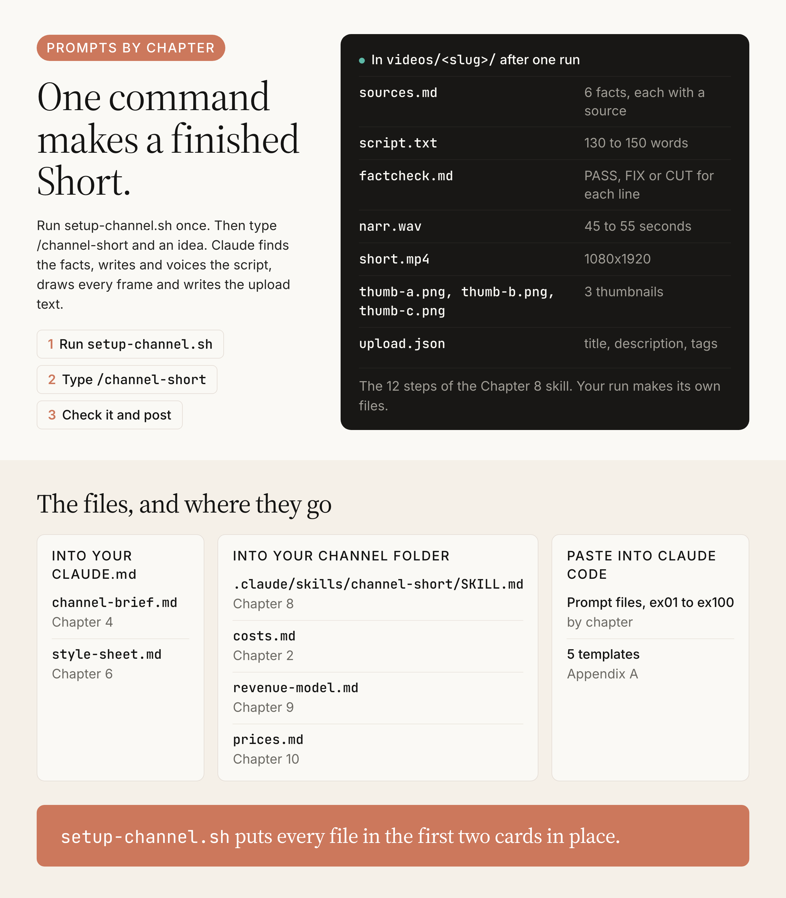

# Grow a Faceless YouTube Channel with Claude

**One command, `/channel-short <idea>`, makes a finished Short. This repo is the channel folder behind it, plus the book's prompts and 5 templates as files you can copy.**

Companion to the book *Grow a Faceless YouTube Channel with Claude* · [youcanbuildthings.com](https://youcanbuildthings.com)

One script copies the book's channel files into a folder on your Mac, so Claude Code reads your channel's rules on every run and can make a whole Short from one line. You'll meet two book words: a *skill* is a saved recipe Claude runs when you type its name (Chapter 8), and a *style sheet* is the short list of look rules every video follows (Chapter 6). Pick your starting point below.

**Educational material, not a promise of views or income: read the [disclaimer](DISCLAIMER.md) before you rely on any number here.**



## Start here

### "I have Claude Code and want my channel folder now"

```bash
git clone https://github.com/regardo911/grow-a-faceless-youtube-channel-with-claude.git && cd grow-a-faceless-youtube-channel-with-claude && ./setup-channel.sh ~/my-channel
```

Then open the folder in Claude Code and give it your first idea:

```bash
cd ~/my-channel && claude
```

```text
/channel-short What if Earth spun twice as fast?
```

That's the fastest path. If `~/my-channel` doesn't exist yet, the script first runs Chapter 2's `init` line (needs node). If it does, the script adds to what's there and never overwrites a file:

```text
added  CLAUDE.md: ## Channel brief  (Chapter 4)
added  CLAUDE.md: ## Style sheet (every Short)  (Chapter 6)
made   .claude/skills/channel-short/SKILL.md  (Chapter 8, the /channel-short skill)
made   costs.md  (Chapter 2)
made   revenue-model.md  (Chapter 9)
made   prices.md  (Chapter 10)
made   videos/approved/
made   videos/posted/
made   refs/
```

Before the first video, change the Niche line and the style sheet's hex codes in your `CLAUDE.md` to yours, and put 3 reference frames in `refs/`.

### "I haven't installed anything yet"

Do [Chapter 2's install lines](chapters/02-your-channel-stack/README.md) first. They take about 15 minutes, mostly downloads. Then run the command above.

### "I just want to copy a prompt"

```bash
pbcopy < chapters/04-scripts-and-voice/ex14-research.txt
```

Then paste into Claude Code. `ex14` is Example 14. Each file holds only the prompt as the book prints it (Appendix A's version for Examples 14 to 18), plus the one-line fix where its chapter gives one.

## Where each file goes

| Chapter | In this repo | In your channel folder |
|---|---|---|
| 4 | `channel-brief.md` | bottom of `CLAUDE.md` (setup does it) |
| 6 | `style-sheet.md` | bottom of `CLAUDE.md`, under the brief (setup does it) |
| 8 | `channel-short/SKILL.md` | `.claude/skills/channel-short/SKILL.md` (setup does it) |
| 2, 9, 10 | `costs.md`, `revenue-model.md`, `prices.md` | the folder root (setup does it) |
| 8 | `upload.py`, `review.html` | the folder root, if you use the ones from my run |
| 9 | `samples/*-SAMPLE.csv` | the folder root, to practise Examples 72 to 76 |
| 10 | `brand-motion/SKILL.md` | `.claude/skills/brand-motion/SKILL.md` in a client's folder |
| 12 | `channel-2-style-sheet.md` | `channel-2/CLAUDE.md`, in place of channel 1's sheet |
| 1 to 12 | `exNN-*.txt`, `*-prompt.txt`, `template-*.txt` | paste into Claude Code |

## Chapter map

| Chapter | What you make | Start with |
|---|---|---|
| [1](chapters/01-the-channel-that-draws-every-frame/) | three sample videos | `ex01-moon-3d-what-if.txt` |
| [2](chapters/02-your-channel-stack/) | the render setup and a cost sheet | the install lines in its README |
| [3](chapters/03-pick-a-niche/) | a niche brief and 30 ranked ideas | `ex08-who-made-it-first.txt` |
| [4](chapters/04-scripts-and-voice/) | three checked scripts and narrations | `ex14-research.txt` |
| [5](chapters/05-your-first-video/) | video 1, live | `ex24-scene-list.txt` |
| [6](chapters/06-animated-and-3d-shorts/) | 20 styles, then 7 Shorts in one | `ex32-3d-cartoon-rings.txt` |
| [7](chapters/07-a-full-7-minute-video/) | a 7-minute documentary | `ex52-directors-brief.txt` |
| [8](chapters/08-one-command-one-video/) | one command per video, posted daily | `/channel-short <idea>` |
| [9](chapters/09-get-paid-by-youtube/) | a revenue model and a weekly loop | `revenue-model-prompt.txt` |
| [10](chapters/10-paid-before-youtube-pays/) | priced offers and a sample | `ex83-price-sheet.txt` |
| [11](chapters/11-the-weekly-check/) | the Sunday check | `template-4-weekly-check.txt` |
| [12](chapters/12-your-second-channel/) | a second channel | `ex93-second-niche.txt` |

## Your week


Sunday is the sitting the schedule needs from you, about an hour (Chapter 8). Start it with [`sunday-prompt.txt`](chapters/08-one-command-one-video/sunday-prompt.txt).

## What it needs to run

- `setup-channel.sh` and the tests: bash, offline, written for the bash that ships with macOS; CI runs them on Ubuntu. The upload.py check also uses python3 when it's there. Only `init`, for a folder that doesn't exist yet, needs node and the network. The install lines are macOS; Chapter 2 has the book's Windows note.
- `/channel-short` is the one that needs your Claude plan. Give it an idea and you get back a finished Short, three thumbnails and its upload text. It and the prompt files run in Claude Code (Pro or higher) with the Chapter 2 tools: Homebrew, node, ffmpeg, Python 3.13 with the Kokoro voice, HyperFrames 0.9.64, and yt-dlp from Chapter 3. Four add one more: Remotion (Example 5), an ElevenLabs key (20), Blender (60), the Claude desktop app (66).
- `upload.py --dry-run` needs `python3`; a live upload needs your own Google sign-in. `review.html` needs a browser.

```bash
bash tests/test-setup.sh     # runs setup-channel.sh on throwaway folders
bash tests/check-files.sh    # every link lands, every example has its file, the upload.py dry run
```

## Contributing

Fixes welcome. Every file maps to a chapter, and a prompt file matches the printed book unless its chapter README says what was added. Found a place where the book doesn't work? Open an issue with the example number; confirmed ones go in [BOOK-FIXES.md](BOOK-FIXES.md).

## License

MIT, see [LICENSE](LICENSE). Prompts that start from someone else's carry the credit next to the file in its chapter README.

Not financial, legal or tax advice. Every number in this repo is one person's run or a labelled practice sample.
